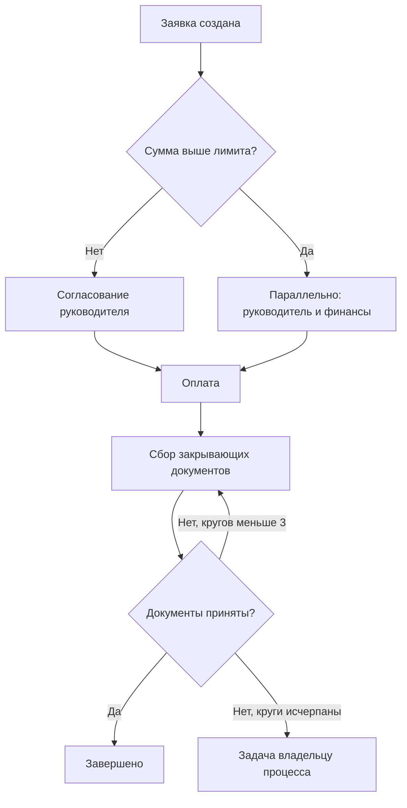
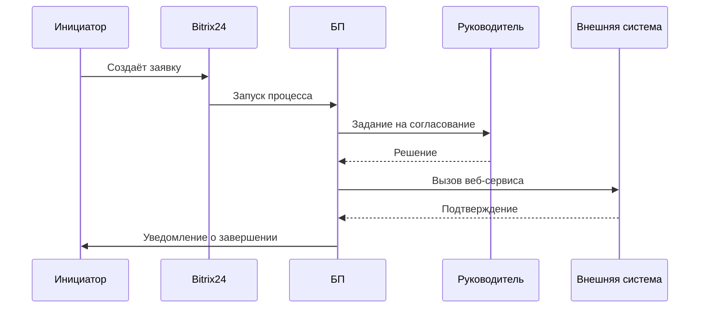

# Моделирование процессов

AS-IS, TO-BE, GAP, BPMN, UML и схемы для Miro. Схема нужна там, где текст не справляется: ветвления, параллельность, передача между ролями. Если процесс линейный из трёх шагов — не рисуй, опиши словами.

---

## AS-IS

Как работает сейчас. Строится по данным, а не по рассказам: сотрудники описывают, как должно быть, и не помнят исключений, которые как раз и составляют большую часть случаев.

Что зафиксировать: участники и роли, этапы и действия, системы и документы, точки передачи информации, ручные операции, существующая автоматизация, места ожидания, дублирование, известные ошибки.

К каждому этапу — цифра: сколько занимает, сколько висит, сколько раз в месяц происходит. AS-IS без цифр не позволяет посчитать эффект, а значит и защитить изменения.

Отдельно помечай на схеме узкие места — там, где стоит очередь. Это делает документ полезным для обсуждения, а не только для архива.

## TO-BE

Как должно работать. Не «то же самое, но быстрее», а пересобранный процесс: параллельные согласования, роли вместо людей, пороги вместо сплошного контроля, сроки и эскалации на каждом шаге ожидания, контрольные точки, уведомления, исключения.

Обязательно продумай отказные сценарии: согласующий в отпуске, исполнитель уволен, повторный отказ, превышение лимита. Именно они порождают зависшие процессы, и именно их обычно не проектируют.

## GAP-анализ

| Область | AS-IS | TO-BE | GAP | Решение | Эффект |
|---|---|---|---|---|---|

Последняя колонка обязательна: без неё таблица описывает разницу, но не обосновывает работу.

---

## BPMN

Используй для процессов с несколькими участниками и ветвлениями. Показывай **кто → что делает → при каком условии → что дальше**.

Элементы, которых обычно достаточно: начальное и конечное события, пользовательская задача, сервисная задача, исключающий и параллельный шлюзы, таймер, сообщение, дорожки участников, подпроцесс.

Практические правила:

- Дорожка на роль, а не на человека.
- Таймер на каждом шаге ожидания — если его нет в схеме, значит его нет и в реальности.
- Отказные ветки рисовать, а не подразумевать.
- Подпроцесс там, где детализация мешает увидеть общую картину.

Если графическую схему выдать нельзя, используй Mermaid:

## UML

Бери ту диаграмму, которая отвечает на конкретный вопрос:

- **Use Case** — кто и что может делать в системе.
- **Sequence** — порядок обмена между системами, особенно при интеграциях.
- **Activity** — логика с ветвлениями внутри одного сценария.
- **State** — жизненный цикл сущности по стадиям. Полезна для смарт-процессов: стадии воронки это и есть состояния.
- **Class** — модель данных: сущности, атрибуты, связи.

Пример последовательности для интеграции:

---

## Схемы для Miro

Miro-схему готовь как структуру, которую можно перенести руками или через коннектор. Для каждой схемы описывай: **название → блоки → связи → расположение → смысл каждого блока.**

Типы, которые чаще всего нужны в проектах на Bitrix24:

- **Process Map** — процесс по дорожкам ролей с подсветкой узких мест.
- **AS-IS / TO-BE рядом** — две карты на одном полотне, чтобы разница читалась без переключения.
- **Architecture Map** — сущности портала и связи между ними: воронки, смарт-процессы, списки, интеграции.
- **Integration Map** — что с чем обменивается данными, в какую сторону, по какому событию.
- **Roadmap** — волны работ с этапами по каждой.
- **Карта ролей** — кто инициирует, согласует, исполняет, владеет.

Правила компоновки: поток слева направо, роли сверху вниз по дорожкам, узкие места одним контрастным цветом, легенда обязательна. Не больше семи блоков в ряду — дальше схема перестаёт читаться.
